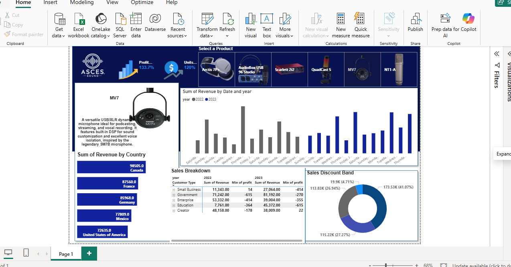

# E-commerce Sales Performance Analysis

An end-to-end sales analysis project using **Microsoft Excel, MySQL and Power BI**. The project explores sales activity across products, countries, customer types and discount bands, then presents the analysis in an interactive Power BI report.

## Project overview

This project examines an e-commerce sales dataset covering 2022 and 2023. It brings together transaction-level sales records, product reference information and monthly discount rates to support a multi-dimensional view of sales performance.

The Power BI report includes product selection, revenue by country, revenue trends over time, a customer-type sales breakdown and a discount-band distribution view.

## Project objectives

- Examine revenue patterns across the available reporting period.
- Compare sales activity across products and geographic markets.
- Explore revenue distribution across customer types.
- Review how recorded sales are distributed across discount bands.
- Combine sales, product and discount reference data for analysis.
- Present the findings in an interactive Power BI dashboard.

## Tools and technologies

- **Microsoft Excel** — spreadsheet-based data review and preparation.
- **MySQL** — querying and joining the sales, product and discount datasets.
- **Microsoft Power BI** — data modelling, measures, visual analysis and dashboard presentation.

## Data files

| File | Description |
|---|---|
| `data/product_sales.csv` | Transaction-level sales records, including date, customer type, country, product identifier, discount band and units sold. |
| `data/Product_data.csv` | Product reference data, including product name, category, cost price, sale price, brand, description and image URL. |
| `data/discount_data.csv` | Monthly discount rates by discount band. |

The supplied transaction file contains **1,046 sales records**. The product reference file contains **6 products**. The discount reference file contains monthly discount-band entries.

## SQL workflow

The SQL script in `sql/salesAnalysis.sql` uses a common table expression (CTE) to:

1. Join sales records to product information using the product identifier.
2. Calculate transaction-level cost and revenue using unit quantities and the product cost and sale prices.
3. Derive month and year fields from the transaction date.
4. Join the monthly discount reference using month and discount band.
5. Calculate revenue after applying the discount rate.

**Note:** The script expects the imported MySQL tables to be named `product_data`, `product_sales` and `discount_data`, with column names matching the supplied source files (including the spaces and punctuation used in the SQL).


## Power BI Dashboard Preview



The report is provided in `powerbi/SALES_DATAANALYSIS.pbix`. The current dashboard presents:

- Product selection and product information.
- Revenue by country.
- Revenue by date, with a year comparison.
- Sales breakdown by customer type and year.
- Sales distribution by discount band.
- Year-over-year KPI cards for profit and units sold.

## Power BI Dashboard Preview


## Repository structure

```text
ecommerce-sales-performance-analysis/
├── README.md
├── dashboard/
│   └── dashboard-preview.png
├── data/
│   ├── product_sales.csv
│   ├── Product_data.csv
│   └── discount_data.csv
├── powerbi/
│   └── SALES_DATAANALYSIS.pbix
└── sql/
    └── salesAnalysis.sql
```

## How to explore the project

1. Review the dashboard preview in `dashboard/`.
2. Open `powerbi/SALES_DATAANALYSIS.pbix` with Microsoft Power BI Desktop to interact with the report.
3. Review the source datasets in `data/`.
4. Open `sql/salesAnalysis.sql` to examine the MySQL query workflow.

## Scope and interpretation

The dashboard and documentation describe the analysis represented in the supplied project files. KPI values can change with product selections and report filters, so figures should be interpreted in the context of the active report selections. Revenue after discount is calculated in the SQL query; it should not be treated as profit. The report's displayed `Min of profit` field is not presented here as total profit by customer type.

## Project deliverables

- Source sales and reference datasets.
- MySQL analysis script.
- Interactive Power BI report.
- Dashboard screenshot for quick review.

---

**Project:** E-commerce Sales Performance Analysis  
**Tools:** Microsoft Excel · MySQL · Power BI
